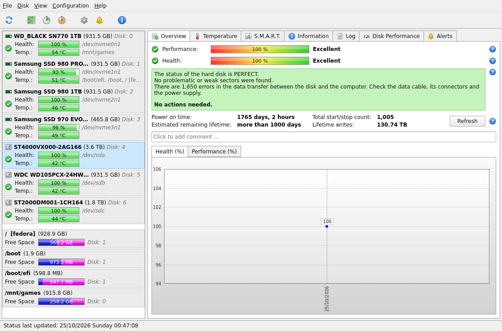
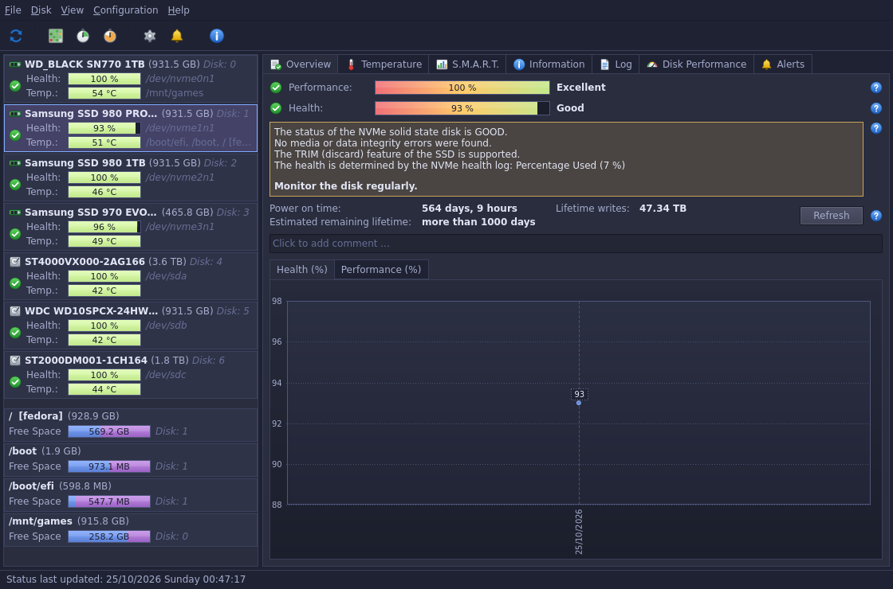
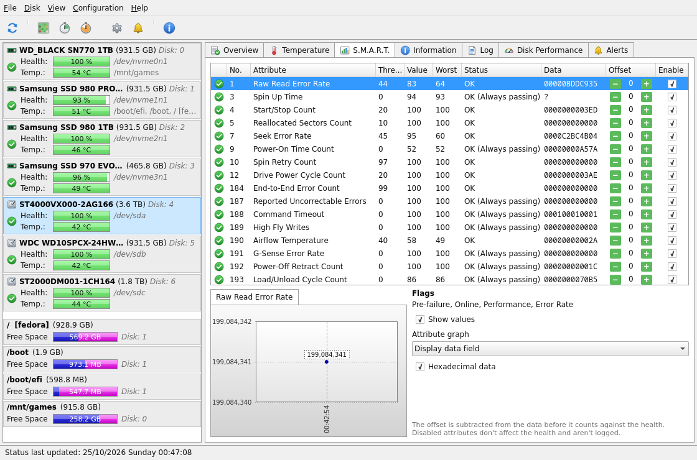
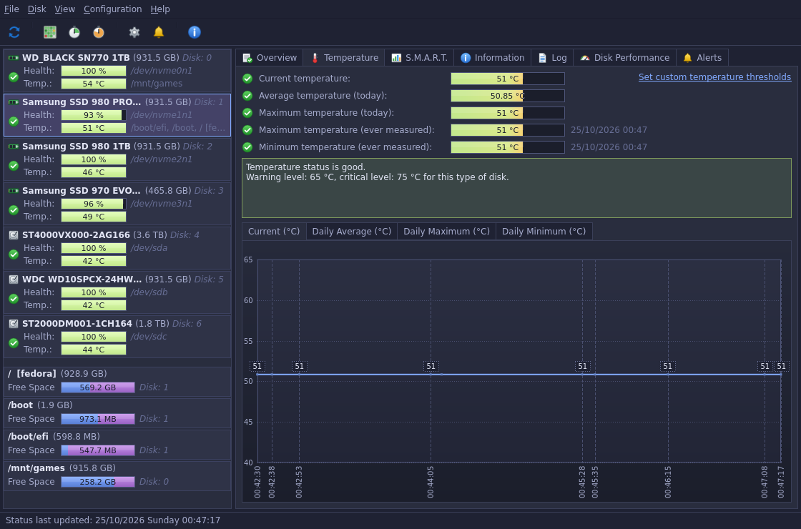

# DiskWarden

A disk health, temperature and S.M.A.R.T. monitor for Linux, built with Qt 6 and QML. Its look and features follow Hard Disk Sentinel on Windows: a list of disks with health and temperature on the left, and Overview, Temperature, S.M.A.R.T., Information, Log, Disk Performance and Alerts pages on the right.

> **This project is entirely vibe-coded.** Every line of code, every icon and this README were written by an AI (Claude, in Claude Code). The author only described what they wanted in chat and never wrote or edited the code by hand. Read and test it with that in mind before you trust it with your disks.

DiskWarden isn't affiliated with Hard Disk Sentinel or its authors.

| Light theme | Dark theme (Palenight) |
| --- | --- |
|  |  |
|  |  |

## Features

- **Health and performance** in percent for HDDs, S-ATA SSDs and NVMe drives, with a text description of what was found and what to do about it.
- **Estimated remaining lifetime**, power-on time, start/stop count and lifetime writes.
- **S.M.A.R.T. table** with threshold, value, worst, status and raw data (hexadecimal or decimal), per-attribute offsets and an enable switch, and a history graph for each attribute. NVMe drives show the fields of their health log the same way.
- **Temperature** now, today's average and maximum, and the highest and lowest temperatures ever measured, with graphs of the last day and of the daily average, maximum and minimum.
- **Information**: model, firmware, serial, interface and its current and maximum speed, disk controller, ATA features (APM, AAM, write cache, NCQ, TRIM...), NVMe controller and namespace details, and partitions.
- **Log** of health changes, changes of the critical attributes (reallocated, pending and uncorrectable sectors, CRC errors...) and test results.
- **Disk performance**: live read and write speed, disk activity, session and lifetime totals, with graphs.
- **Alerts** as desktop notifications when a disk predicts failure, its health or temperature crosses a threshold, a new problem is logged or a volume runs out of space.
- **Self-tests**: short, extended and conveyance tests run by the disk's firmware, with progress.
- **Surface test**: a non-destructive read test of the whole disk (or a quick sampling one) with a block map colored by read speed, unreadable sector detection, and graphs of temperature and transfer speed over the disk.
- **Tray icon** showing the highest temperature on a background colored by the worst status. Closing the window keeps DiskWarden running in the tray.
- **Light theme** in the classic Windows style and a **dark theme** after Material Palenight. By default the desktop's color scheme decides.

## How it works

DiskWarden reads everything through [udisks2](https://github.com/storaged-project/udisks) on the system D-Bus, so monitoring doesn't need root. Hard disks in standby aren't woken up unless you allow it in the configuration. Self-tests and the surface test go through udisks2 as well and ask for the administrator password via polkit. The surface test opens the disk read-only.

Temperatures, health, attribute changes, the log and the alerts are kept in an SQLite database in `~/.local/share/DiskWarden/`. Settings are in `~/.config/DiskWarden/DiskWarden.conf`.

### Health

The health starts at 100 % and is multiplied down by every problem found in the critical attributes, using the weights and limits Hard Disk Sentinel documents for its "analyse data field" method:

| Attribute | Weight | Limit |
| --- | --- | --- |
| #5 Reallocated sectors | 1 | 70 % |
| #7 Seek errors | 0.5 | 20 % |
| #10 Spin retries | 3 | 60 % |
| #196 Reallocation events | 0.6 | 30 % |
| #197 Pending sectors | 0.6 | 48 % |
| #198 Off-line uncorrectable sectors | 1 | 70 % |

For example, 2 reallocated sectors give 98 %, and 5 pending sectors on top of them give 98 % × 97 % = 95 %. For SSDs the wear attribute the drive reports (#169, #177, #202, #231, #233...) is taken into account, and for NVMe drives the health is 100 % minus *Percentage Used*, lowered further by a shrinking spare area or media errors. A failing self-assessment or an attribute at its threshold caps the health at 10 %. Seagate's seek error rate is a packed rate, not a count, so it doesn't lower the health.

The performance is 25 % performance attributes, 25 % data transfer (CRC) errors of the last 30 days and 50 % the interface speed compared to the fastest the disk and its port support.

## Building

You need CMake 3.21+, a C++20 compiler and Qt 6.5 or later with Qt Quick, Qt Quick Controls, D-Bus, SQL (SQLite) and Widgets. At runtime udisks2 and the Qt SVG image plugin are needed.

On Fedora:

```bash
sudo dnf install cmake ninja-build gcc-c++ qt6-qtbase-devel qt6-qtdeclarative-devel qt6-qtsvg udisks2
```

Then:

```bash
cmake -S . -B build -G Ninja -DCMAKE_BUILD_TYPE=Release
cmake --build build
./build/diskwarden
```

`ctest --test-dir build` runs the unit tests of the health calculation, attribute decoding and formatting. `cmake --install build` installs the program, its desktop entry and icon.

### Command line

- `--minimized` starts in the tray (used by "Start when I log in").
- `--screenshot <directory> [--disk <index>]` saves every page as a PNG and quits; with `QT_QPA_PLATFORM=offscreen` it works without a display.

## Status

This is an early version. Monitoring, health, the pages, alerts, themes and the tray work on the developer's machine with S-ATA hard disks and NVMe SSDs. The self-tests and the surface test need the administrator password and haven't been run on a real disk yet. USB disks behind bridges that don't pass S.M.A.R.T. through show an unknown health.

## License

DiskWarden is free software, released under the [GNU General Public License version 2](LICENSE) (GPL-2.0-only).
